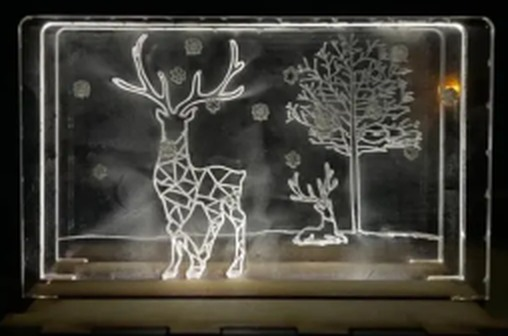

# Laser-Cut Night Light Workshop (Dec 2022 – Feb 2023)

I was the lead organizer of a winter laser-cutting workshop run by our department student association at National Taiwan University. I designed the night-light kit that the junior-high and high-school participants built, prepared the teaching material, and ran the planning meetings.

*A finished light. The engraved artwork on each light was drawn by a participant and is not included in this repository.*

## The kit

A three-layer acrylic night light on a laser-cut wooden base, designed in SolidWorks (`night_light/`):

- **Wooden enclosure:** base, top, front, back and side panels.
- **LED tray:** holds the LED strip under the acrylic layers.
- **Acrylic layers:** a front acrylic panel plus a retainer plate that holds the acrylic in place. Each participant's drawing is engraved on an acrylic panel, and edge light from the LED strip makes the engraving glow.

`night_light/dxf/` has the cutting files for every flat part. `led_tray.SLDDRW` is the drawing for the LED tray.

### Earlier concepts (`concepts/`)

- `night_light_v1/`: first version, a wooden box with an LED holder and a single engraved acrylic panel.

## Workshop process

1. **Draw:** each participant draws their design on paper.
2. **Scan:** drawings are scanned to JPG, one file per participant.
3. **Vectorize (Inkscape):** import the acrylic panel DXF and the scan, scale the scan to real size, trace the bitmap into vector paths, delete the raster image, and save as DXF.
4. **Laser cut (RDWorks V8):** import the DXF, align it to the panel outline, then engrave and cut.
5. **Solder:** pre-tin the pads on the LED strip, lay the wire on the solder and press it in with the iron until the solder melts. Check the strip's polarity. Wire insulation lengths and battery-box wire trimming are standardized for every kit.
6. **Assemble:** fit the LED tray, acrylic layers and panels into the wooden enclosure.

Helpers walked the room during the hands-on parts to help participants who got stuck, and every helper learned the full assembly sequence beforehand.

## Notes

- File names were translated from Chinese to English for this repository; `FILE_MAP.csv` lists the original names. The assemblies were saved with the original names, so SolidWorks may ask you to locate referenced parts.
- Participant drawings, names and the participant list are not included.

Tools: SolidWorks, laser cutting (RDWorks V8), Inkscape, soldering.
